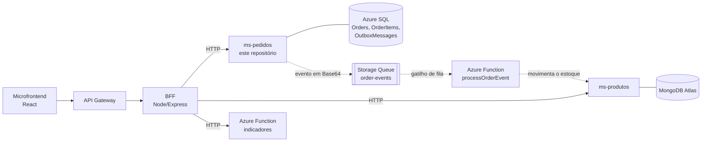
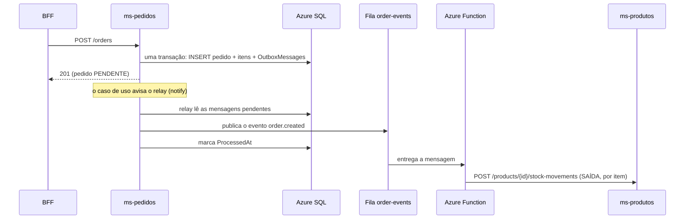
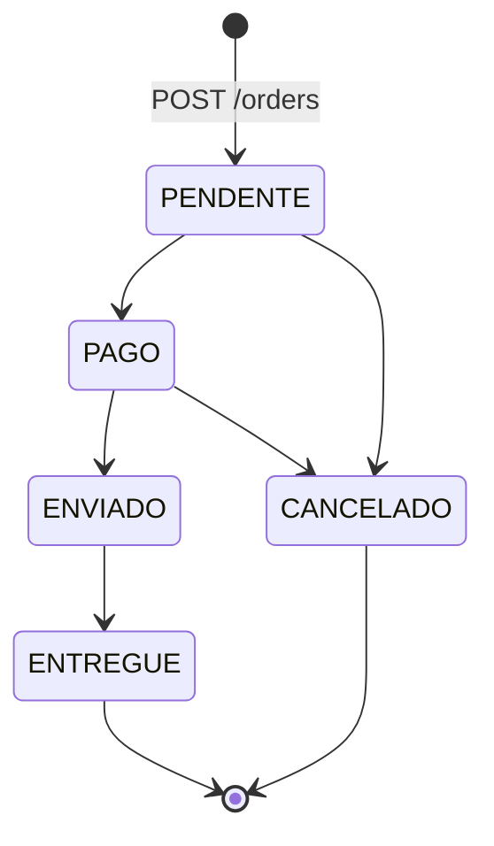

# pjbl-ms-pedidos

Microserviço de **Pedidos** do **Conecta Store**, o sistema que montamos para o PJBL de Arquitetura (aplicação distribuída com microfrontend, BFF, dois microserviços, Azure Function e API Gateway).

Este serviço cuida do ciclo de vida dos pedidos: cria, lista, edita, muda o status e exclui. Os dados ficam no **Azure SQL** e, sempre que um pedido é criado ou cancelado, o serviço publica um **evento** numa fila para que o estoque seja atualizado em outro microserviço, sem que um chame o outro diretamente.

- Swagger (HTTP): `{{URL_MS_PEDIDOS}}/docs`
- Documentação dos eventos (AsyncAPI): `{{URL_MS_PEDIDOS}}/events/docs`

## Sumário

- [Arquitetura](#arquitetura)
- [Tecnologias](#tecnologias)
- [Estrutura de pastas](#estrutura-de-pastas)
- [Endpoints](#endpoints)
- [Regras de negócio](#regras-de-negócio)
- [Eventos e o Transactional Outbox](#eventos-e-o-transactional-outbox)
- [Variáveis de ambiente](#variáveis-de-ambiente)
- [Como rodar localmente](#como-rodar-localmente)
- [Testes](#testes)
- [Docker](#docker)
- [Limitações conhecidas](#limitações-conhecidas)
- [Links na nuvem](#links-na-nuvem)
- [Alunos](#alunos)

## Arquitetura

O ms-pedidos é um dos dois microserviços que ficam atrás do BFF. O front nunca fala com ele direto: o caminho é sempre **Microfrontend → API Gateway → BFF → ms-pedidos**.



As setas pontilhadas são a parte **orientada a eventos**. O caminho completo de um evento é este:



Quando o pedido é cancelado acontece a mesma coisa com o evento `order.cancelled`, e a Function registra uma ENTRADA (devolução) para cada item.

Por dentro, o serviço segue **Clean Architecture** com **Vertical Slices**:

| Camada | O que tem | Pode depender de |
|---|---|---|
| `domain` | o agregado `Order`, a máquina de estados, os erros e os eventos de domínio | nada (TypeScript puro, sem nenhum pacote) |
| `application` | os casos de uso, um por feature, e as portas (interfaces) | `domain`, `zod` e `node:crypto` |
| `infrastructure` | SQL, repositório em memória, fila, relay do outbox, configuração | `application` e `domain` |
| `api` | Express: uma rota por feature, middlewares, OpenAPI/AsyncAPI | `application` e `domain` |
| `main.ts` | cria tudo e liga as peças (composition root) | é o único que conhece `infrastructure` e `api` juntas |

Essas regras não ficam só no papel: os [testes de arquitetura](#testes-de-arquitetura) quebram o build se alguém importar algo no lugar errado.

## Tecnologias

- **Node.js 22** + **TypeScript 5.9** (modo `strict`)
- **Express 5** para a API HTTP
- **Azure SQL Database** com o driver `mssql` (consultas parametrizadas e transações)
- **Azure Storage Queue** com `@azure/storage-queue` (em desenvolvimento, **Azurite**)
- **zod** para validar a entrada
- **pino** / **pino-http** para logs em JSON com `x-correlation-id`
- **swagger-ui-express** (OpenAPI 3) e **AsyncAPI 2.6** para a documentação
- **helmet** e **cors**
- **Vitest** + **supertest** nos testes
- **Docker** (imagem multi-stage `node:22-alpine`) e **GitHub Actions**

## Estrutura de pastas

```
src/
├── domain/                      # regras de negócio, sem nenhuma dependência externa
│   ├── errors.ts                # DomainError (422), ValidationError (400), NotFoundError (404), ConflictError (409)
│   ├── order/
│   │   ├── Order.ts             # agregado: cria, edita, muda status, gera eventos (pullEvents)
│   │   ├── OrderStatus.ts       # máquina de estados
│   │   ├── OrderRules.ts        # limites (1 a 20 itens, quantidade 1 a 999...)
│   │   └── OrderEvents.ts       # order.created e order.cancelled
│   └── shared/                  # dinheiro (arredondamento) e UUID
├── application/
│   ├── ports/                   # OrderRepository, OutboxRepository, EventPublisher, OutboxSignal
│   ├── features/                # um caso de uso por pasta (vertical slice)
│   │   ├── CreateOrder/CreateOrder.ts             # schema zod + CreateOrderHandler
│   │   ├── ListOrders/ListOrders.ts
│   │   ├── GetOrder/GetOrder.ts
│   │   ├── UpdateOrder/UpdateOrder.ts
│   │   ├── ChangeOrderStatus/ChangeOrderStatus.ts
│   │   ├── DeleteOrder/DeleteOrder.ts
│   │   ├── ListOrderEvents/ListOrderEvents.ts
│   │   └── DispatchOrderEvents/DispatchOrderEvents.ts
│   ├── events/                  # envelope do evento e conversão para mensagem do outbox
│   ├── validation.ts            # validate(schema, input) -> ValidationError com { field, message }
│   └── views.ts, schemas.ts, findOrder.ts, errors.ts   # o que é comum a mais de uma feature
├── infrastructure/
│   ├── sql/                     # connectSql (com retry), migração, SqlOrderRepository, SqlOutboxRepository
│   ├── memory/                  # repositórios em memória com o mesmo comportamento do SQL
│   ├── messaging/               # AzureQueueEventPublisher (Base64) e LogEventPublisher
│   ├── outbox/OutboxRelay.ts    # relay em background do outbox
│   ├── config.ts                # leitura das variáveis de ambiente
│   └── logger.ts
├── api/
│   ├── features/                # um adaptador HTTP por feature
│   │   └── CreateOrder/CreateOrderEndpoint.ts     # mapCreateOrder(router, handler)  (idem para as outras 7)
│   ├── middlewares/             # correlationId, apiKey, errorHandler
│   ├── openapi.ts               # documento OpenAPI 3
│   ├── asyncapi.ts, eventsDocs.ts   # leitura do docs/asyncapi.yaml e a página /events/docs
│   └── app.ts                   # createApp(deps)
└── main.ts                      # composition root

docs/
├── asyncapi.yaml                # contrato dos eventos (servido em /events/asyncapi.yaml)
└── schema.sql                   # DDL das tabelas (o serviço cria sozinho na subida)

tests/
├── unit/                        # domínio, casos de uso, infraestrutura
├── integration/                 # HTTP (supertest) e SQL real (opcional)
├── architecture/                # dependencyScanner + regras de arquitetura
└── support/                     # dados de exemplo, fakes e o contrato dos repositórios
```

Cada feature existe em dois lugares com o mesmo nome: `application/features/<Feature>/<Feature>.ts` (o caso de uso, classe `<Feature>Handler`) e `api/features/<Feature>/<Feature>Endpoint.ts` (a rota, que só traduz HTTP para a chamada do handler). Uma feature nunca importa outra; o que é compartilhado fica fora da pasta `features/`.

## Endpoints

A documentação completa, com exemplos, está no Swagger (`/docs`). Resumo:

| Método e rota | O que faz | Respostas |
|---|---|---|
| `POST /orders` | Cria um pedido (`PENDENTE`) e grava o evento `order.created` | 201 + `Location`; 400 `VALIDATION_ERROR`; 422 `DUPLICATED_ITEM` |
| `GET /orders` | Lista com `?status&search&page=1&pageSize=20` (máx. 100), mais recentes primeiro | 200 `{ items, total, page, pageSize }` |
| `GET /orders/:id` | Busca um pedido | 200; 404 `ORDER_NOT_FOUND` (id que não é UUID também dá 404) |
| `PUT /orders/:id` | Edita nome, e-mail e observação do cliente | 200; 409 `ORDER_NOT_EDITABLE` se não estiver `PENDENTE` |
| `PATCH /orders/:id/status` | Muda o status `{ "status": "PAGO" }` | 200; 409 `INVALID_STATUS_TRANSITION`; 409 `CONCURRENT_UPDATE` |
| `DELETE /orders/:id` | Exclui um pedido | 204; 409 `ORDER_NOT_DELETABLE` se não estiver `CANCELADO` |
| `GET /events` | Lista o outbox com `?limit=20` (máx. 100) | 200 `{ items, total }` com status `PUBLICADO`, `PENDENTE` ou `FALHOU` |
| `POST /events/dispatch` | Força uma rodada de publicação | 200 `{ published, failed, pending }` |
| `GET /events/docs` | Página com a documentação dos eventos (AsyncAPI) | HTML |
| `GET /events/asyncapi.yaml` e `.json` | Especificação AsyncAPI 2.6.0 | YAML / JSON |
| `GET /health` | Saúde do serviço (não consulta o banco) | 200 `{ status, service, database, publisher, uptime, timestamp }` |
| `GET /docs`, `GET /openapi.json` | Swagger UI e documento OpenAPI | `GET /` redireciona para `/docs` |

Todo pedido devolvido (inclusive na listagem) traz `allowedTransitions`, a lista de status para os quais ele pode ir, e `itemCount`, a soma das quantidades.

Erros seguem sempre o mesmo formato:

```json
{
  "error": {
    "code": "VALIDATION_ERROR",
    "message": "Dados inválidos.",
    "details": [{ "field": "items.0.quantity", "message": "Deve ser no mínimo 1." }],
    "correlationId": "5d1c7a90-2b7e-4d55-8f0a-6c1e2d3f4a5b"
  }
}
```

| Situação | HTTP | `code` |
|---|---|---|
| Corpo ou consulta inválidos | 400 | `VALIDATION_ERROR` (com `details`) |
| JSON malformado | 400 | `INVALID_JSON` |
| Chave interna ausente ou errada | 401 | `UNAUTHORIZED` |
| Pedido não existe | 404 | `ORDER_NOT_FOUND` |
| Rota não existe | 404 | `ROUTE_NOT_FOUND` |
| Conflito com o estado do pedido | 409 | `INVALID_STATUS_TRANSITION`, `CONCURRENT_UPDATE`, `ORDER_NOT_EDITABLE`, `ORDER_NOT_DELETABLE` |
| Regra de negócio | 422 | `DUPLICATED_ITEM` |
| Erro inesperado | 500 | `INTERNAL_ERROR` |
| Banco acordando | 503 | `DATABASE_UNAVAILABLE` (com `Retry-After: 10`) |

O cabeçalho `x-correlation-id` é reaproveitado se vier na requisição (o BFF manda o dele) ou gerado na hora. Ele volta na resposta, aparece nos logs e vai dentro do evento publicado, então dá para seguir uma requisição do front até a baixa do estoque.

## Regras de negócio

- Um pedido tem de **1 a 20 itens** e **não pode repetir produto** (422 `DUPLICATED_ITEM`).
- Quantidade de **1 a 999** por item, preço unitário **maior que zero**, e-mail válido (guardado em minúsculas).
- O **total** é calculado pelo serviço: soma dos subtotais, arredondada em 2 casas.
- Os **itens não podem ser alterados** depois que o pedido é criado.
- Dados do cliente (nome, e-mail, observação) só podem ser editados enquanto o pedido está **PENDENTE**.
- Só pedido **CANCELADO** pode ser excluído.

Máquina de estados:



Qualquer outra transição devolve 409 `INVALID_STATUS_TRANSITION`.

**Concorrência otimista.** A mudança de status é gravada com `UPDATE ... WHERE Id = @id AND Status = @statusQueFoiLido`. Se duas requisições tentarem cancelar o mesmo pedido ao mesmo tempo, a segunda não encontra mais o status que tinha lido, não altera nada e recebe 409 `CONCURRENT_UPDATE`. Sem isso, dois cancelamentos simultâneos gerariam dois eventos e o estoque seria devolvido em dobro. O repositório em memória reproduz o mesmo comportamento.

## Eventos e o Transactional Outbox

O problema que o outbox resolve: se o serviço gravasse o pedido no banco e *depois* mandasse a mensagem para a fila, uma queda entre os dois passos deixaria um pedido sem evento (estoque nunca baixado). Então:

1. Criar ou cancelar um pedido grava o pedido **e** uma linha em `OutboxMessages` na **mesma transação** SQL. Ou gravam os dois, ou nenhum.
2. O **relay** (roda dentro do próprio serviço) lê as mensagens pendentes, publica cada uma na fila `order-events` e marca `ProcessedAt`.
3. Se a publicação falhar, ele grava o erro em `LastError`, soma `Attempts` e tenta de novo depois de `OUTBOX_INTERVAL_MS`.

A mensagem na fila é o JSON do evento codificado em **Base64** (é o que o gatilho de fila do Azure Functions espera):

```json
{
  "eventId": "0b6f3c52-8a41-4f0e-9a57-3d2c1b0a9e8d",
  "type": "order.created",
  "version": 1,
  "source": "ms-pedidos",
  "occurredAt": "2025-06-10T14:30:00.000Z",
  "correlationId": "5d1c7a90-2b7e-4d55-8f0a-6c1e2d3f4a5b",
  "data": {
    "orderId": "7f9c2b1e-4d3a-4c8e-9b2f-1a2b3c4d5e6f",
    "customerName": "Ana Souza",
    "customerEmail": "ana@exemplo.com",
    "status": "PENDENTE",
    "total": 49.8,
    "items": [{ "productId": "c0ffee00-...", "productName": "Café torrado 500g", "quantity": 2, "unitPrice": 24.9 }]
  }
}
```

A entrega é **pelo menos uma vez**: se o serviço cair depois de publicar e antes de marcar `ProcessedAt`, a mensagem sai de novo. Por isso o consumidor é idempotente (usa o `eventId`). O contrato completo está em [`docs/asyncapi.yaml`](docs/asyncapi.yaml) e renderizado em `/events/docs`.

### Por que o relay não fica consultando o banco o tempo todo

A primeira ideia era um timer consultando o outbox a cada 3 segundos. O problema é que o Azure SQL gratuito é *serverless*: ele pausa sozinho depois de um tempo sem uso e tem uma cota mensal de processamento. Um relay batendo no banco a cada 3 segundos nunca deixaria o banco pausar e acabaria com a cota em poucos dias.

Por isso o relay é **orientado a sinal**: o caso de uso que grava um evento avisa o relay (`OutboxSignal.notify()`), e ele publica na hora. Se sobrar algo pendente (falha na fila, por exemplo), ele agenda uma nova tentativa em `OUTBOX_INTERVAL_MS`; quando o outbox fica vazio, ele para: nenhum timer e nenhuma consulta. Na subida do serviço há uma varredura única, para pegar o que tenha ficado para trás numa queda. Pelo mesmo motivo, o `/health` não consulta o banco.

## Variáveis de ambiente

| Variável | Padrão | Para que serve |
|---|---|---|
| `PORT` | `3002` | Porta HTTP |
| `DB_DRIVER` | `sql` se houver connection string, senão `memory` | `sql` ou `memory` |
| `SQL_CONNECTION_STRING` | (vazio) | Connection string do Azure SQL no formato ADO: `Server=tcp:...,1433;Database=...;User ID=...;Password=...;Encrypt=true;Connection Timeout=60` |
| `QUEUE_CONNECTION_STRING` | (vazio) | Connection string da conta de armazenamento. Sem ela os eventos só vão para o log. Com Azurite: `UseDevelopmentStorage=true` |
| `QUEUE_NAME` | `order-events` | Nome da fila |
| `OUTBOX_INTERVAL_MS` | `3000` | Espera antes de tentar publicar de novo quando sobra evento pendente |
| `INTERNAL_API_KEY` | (vazio) | Se definida, `/orders` e `/events` exigem o cabeçalho `x-api-key` (o BFF envia). `/health`, `/docs`, `/openapi.json`, `/events/docs` e `/events/asyncapi.*` continuam abertos |
| `CORS_ORIGIN` | `*` | Origem liberada no CORS (ou lista separada por vírgula) |
| `LOG_LEVEL` | `info` | Nível de log do pino |
| `PUBLIC_URL` | (vazio) | Endereço público do serviço, usado no Swagger |
| `SQL_TEST_CONNECTION_STRING` | (vazio) | Só para os testes: habilita o teste de integração com SQL real |

Nenhum segredo fica no repositório. O `.env.example` só tem valores fictícios, e o `.env` de verdade está no `.gitignore` e no `.dockerignore`. Na nuvem, as connection strings e a chave interna entram como *secrets* do Container App.

## Como rodar localmente

Precisa de **Node.js 22 ou mais novo**.

```bash
git clone https://github.com/devinigarcia/pjbl-ms-pedidos.git
cd pjbl-ms-pedidos
npm install
```

### 1. Modo memória (o mais simples)

Sem nenhuma variável de ambiente o serviço guarda os pedidos em memória e só escreve os eventos no log. Bom para conhecer a API.

```bash
npm run dev
```

Abra <http://localhost:3002/docs> (Swagger) e <http://localhost:3002/events/docs> (eventos). Um fluxo rápido pelo terminal:

```bash
# cria um pedido (guarde o "id" da resposta)
curl -X POST http://localhost:3002/orders -H "Content-Type: application/json" \
  -d '{"customerName":"Ana Souza","customerEmail":"ana@exemplo.com","items":[{"productId":"p-1","productName":"Café torrado 500g","unitPrice":24.9,"quantity":2}]}'

# o evento order.created aparece no outbox
curl http://localhost:3002/events

# cancela (gera order.cancelled) e depois exclui
curl -X PATCH http://localhost:3002/orders/ID_DO_PEDIDO/status -H "Content-Type: application/json" -d '{"status":"CANCELADO"}'
curl -X DELETE http://localhost:3002/orders/ID_DO_PEDIDO
```

### 2. Com a fila (Azurite)

O [Azurite](https://learn.microsoft.com/azure/storage/common/storage-use-azurite) é o emulador do Azure Storage. Em um terminal:

```bash
npx azurite --silent --location .azurite
```

Em outro, crie o arquivo `.env` a partir do exemplo e ligue a fila:

```bash
cp .env.example .env        # no PowerShell: Copy-Item .env.example .env
```

```ini
# .env
QUEUE_CONNECTION_STRING=UseDevelopmentStorage=true
```

```bash
npm run dev
```

Agora o `/health` mostra `"publisher": "azure-queue"` e cada pedido criado ou cancelado vira uma mensagem na fila `order-events` (o `GET /events` mostra `PUBLICADO`). Se a Azure Function do projeto (`pjbl-function`) estiver rodando com `func start` apontando para o mesmo Azurite, ela consome a mensagem e movimenta o estoque no ms-produtos. Para ver uma falha de publicação, pare o Azurite e crie um pedido: o evento fica como `FALHOU`, com o erro em `lastError`, e é publicado sozinho quando o Azurite volta.

### 3. Com Azure SQL

Coloque no `.env` a connection string que o portal do Azure mostra em *Cadeias de conexão → ADO.NET* (troque o usuário e a senha):

```ini
# .env
SQL_CONNECTION_STRING=Server=tcp:SEU-SERVIDOR.database.windows.net,1433;Database=pjbl-pedidos;User ID=SEU-USUARIO;Password=SUA-SENHA;Encrypt=true;Connection Timeout=60
```

No firewall do servidor SQL é preciso liberar o seu IP (para rodar da sua máquina) e marcar *Permitir que serviços do Azure acessem este servidor* (para o Container App).

Na subida o serviço cria as tabelas e os índices sozinho, se ainda não existirem (o DDL está em [`docs/schema.sql`](docs/schema.sql)). Se o banco gratuito estiver pausado, a subida espera ele acordar (até 6 tentativas, pouco mais de um minuto). Funciona igual com um SQL Server local em Docker; nesse caso acrescente `TrustServerCertificate=true` na connection string.

### Scripts

| Comando | O que faz |
|---|---|
| `npm run dev` | sobe com recarga automática (`tsx watch`) |
| `npm run build` | compila para `dist/` |
| `npm start` | roda o que foi compilado (`node dist/main.js`) |
| `npm run typecheck` | checagem de tipos, sem gerar arquivos |
| `npm test` | todos os testes |
| `npm run test:arch` | só os testes de arquitetura |

## Testes

```bash
npm test
```

São 210 testes que rodam sem depender de nada externo (mais 18 de SQL real, que ficam *skipped* se o banco não for informado):

- **Domínio** (`tests/unit/domain`): regras do pedido, as 25 combinações da máquina de estados (5 válidas e 20 inválidas) e os eventos gerados.
- **Casos de uso** (`tests/unit/application`): cada feature em cima do repositório em memória e de um publisher de mentira. Confere, por exemplo, que o evento entra no outbox junto com o pedido, que dois cancelamentos simultâneos geram um evento só e que uma falha de publicação vira `FALHOU` e é resolvida na tentativa seguinte.
- **Infraestrutura** (`tests/unit/infrastructure`): mensagem em Base64 no publisher da fila, o relay com relógio falso (publica na hora, reagenda na falha, fica ocioso com o outbox vazio), o retry para o banco acordando, configuração, e o `docs/schema.sql` comparado com a migração.
- **HTTP** (`tests/integration/http.test.ts`): a aplicação Express inteira com supertest, incluindo o formato de cada erro, a chave interna e as páginas de documentação.
- **Arquitetura** (`tests/architecture`): ver abaixo.

### Testes de arquitetura

```bash
npm run test:arch
```

O `tests/architecture/dependencyScanner.ts` é um scanner caseiro (sem biblioteca): lê os `.ts` de `src/`, extrai os imports por expressão regular e classifica cada arquivo por camada e por feature. As regras verificadas:

- `domain` não importa nenhuma outra camada e não usa nenhum pacote;
- `application` não importa `infrastructure` nem `api`, e só usa `zod` e `node:crypto`;
- `infrastructure` não importa `api`; `api` não importa `infrastructure` (só o `main.ts` conhece as duas);
- `mssql` e `@azure/storage-queue` só aparecem em `infrastructure`; `express` e companhia só em `api`;
- uma feature não importa outra feature;
- toda feature de `application` tem o seu `api/features/<F>/<F>Endpoint.ts`, e cada `<F>.ts` exporta a classe `<F>Handler`.

**Para ver um teste de arquitetura falhar**, plante uma violação. Por exemplo, adicione esta linha no topo de `src/application/features/GetOrder/GetOrder.ts`:

```ts
import sql from 'mssql';
```

e rode `npm run test:arch`. Duas regras falham, com a mensagem apontando o arquivo:

```
× Application não depende de Infrastructure/API e só usa zod e node:crypto
    + "application/features/GetOrder/GetOrder.ts usa o pacote mssql"
× mssql e @azure/storage-queue só aparecem na Infrastructure
    + "application/features/GetOrder/GetOrder.ts usa mssql, que só pode aparecer em infrastructure"
```

Apague a linha e os testes voltam a passar. O próprio arquivo de teste também tem um bloco ("as regras detectam violações") que alimenta as regras com arquivos de mentira, para garantir que elas continuam pegando cada tipo de problema.

### Teste de integração com SQL real

`tests/integration/sqlRepositories.test.ts` só roda quando `SQL_TEST_CONNECTION_STRING` está definida. Ele cobre a migração idempotente (roda duas vezes), criar e ler, listagem com filtro e paginação, o outbox na mesma transação do pedido (incluindo o rollback), a concorrência otimista e a exclusão em cascata dos itens. Boa parte desses testes é o mesmo "contrato" que roda contra o repositório em memória, justamente para garantir que os dois se comportam igual.

```powershell
# PowerShell
$env:SQL_TEST_CONNECTION_STRING = "Server=tcp:SEU-SERVIDOR.database.windows.net,1433;Database=pjbl-pedidos;User ID=SEU-USUARIO;Password=SUA-SENHA;Encrypt=true;Connection Timeout=60"
npm test -- tests/integration/sqlRepositories.test.ts
```

```bash
# bash
SQL_TEST_CONNECTION_STRING="Server=tcp:...;Database=...;User ID=...;Password=...;Encrypt=true" npm test -- tests/integration/sqlRepositories.test.ts
```

Os testes só mexem em registros que eles mesmos criam (marcados com um texto único) e apagam tudo no final, mas o ideal é usar um banco separado do que está em produção.

## Docker

A imagem é multi-stage (`node:22-alpine`): a primeira etapa instala tudo e compila; a final leva só `dist/`, as dependências de produção e o `docs/asyncapi.yaml`, roda com o usuário `node` (sem root) e tem `HEALTHCHECK` em `/health`.

```bash
docker build -t {{DOCKERHUB_USER}}/pjbl-ms-pedidos:v1 .
docker login
docker push {{DOCKERHUB_USER}}/pjbl-ms-pedidos:v1
```

Para rodar a imagem:

```bash
# modo memória
docker run --rm -p 3002:3002 {{DOCKERHUB_USER}}/pjbl-ms-pedidos:v1

# com as variáveis do seu .env (SQL, fila etc.)
docker run --rm -p 3002:3002 --env-file .env {{DOCKERHUB_USER}}/pjbl-ms-pedidos:v1
```

**Sobre o nome da imagem.** O enunciado dá como exemplo `dockerhubuser/pjbl/bff:v1` (registro/repositório/imagem). O Docker Hub, porém, não aceita namespace aninhado: o nome precisa ser `usuario/repositorio:tag`, com um nível só. Por isso o `pjbl` virou prefixo do nome do repositório: `{{DOCKERHUB_USER}}/pjbl-ms-pedidos:v1` (e, nos outros projetos, `pjbl-bff` e `pjbl-ms-produtos`).

**Publicação automática.** O workflow [`.github/workflows/ci.yml`](.github/workflows/ci.yml) tem dois jobs:

1. `test`: `npm ci`, checagem de tipos, testes e build, em todo push e pull request;
2. `docker`: no push para a `main`, constrói a imagem e publica no Docker Hub com as tags `v1`, `latest` e `sha-<commit>`.

Para o segundo job funcionar, cadastre no repositório (Settings → Secrets and variables → Actions) os secrets `DOCKERHUB_USERNAME` e `DOCKERHUB_TOKEN` (um *access token* gerado no Docker Hub, não a senha). Sem eles o job não falha: só avisa e pula a publicação.

## Limitações conhecidas

- **Banco gratuito que "dorme".** O Azure SQL gratuito pausa quando fica sem uso e leva cerca de um minuto para acordar. Nesse intervalo as consultas falham. O repositório SQL repete a operação inteira por até uns 20 segundos; se ainda assim não der, a API responde **503 `DATABASE_UNAVAILABLE`** com `Retry-After: 10`. Basta repetir a chamada alguns segundos depois. Antes de uma demonstração vale fazer uma chamada qualquer para acordar o banco.
- **Uma réplica só.** O relay do outbox vive dentro do processo. Com mais de uma réplica, o aviso (`notify`) só chegaria na réplica que gravou o pedido e uma varredura de subida poderia publicar um evento repetido. Não causaria erro (o consumidor é idempotente), mas por simplicidade o Container App roda com 1 réplica.
- **Entrega pelo menos uma vez, sem garantia de ordem.** É o que a Storage Queue oferece. Em um cenário raro, o `order.cancelled` pode chegar antes do `order.created` do mesmo pedido.
- **Sem autenticação de usuário.** A proteção é a chave interna (`x-api-key`) entre o BFF e o serviço; quem cuida da entrada pública é o API Gateway.
- **Itens imutáveis.** Para mudar os itens é preciso cancelar o pedido e criar outro.

## Links na nuvem

| O quê | Endereço |
|---|---|
| Swagger do ms-pedidos | `{{URL_MS_PEDIDOS}}/docs` |
| Documentação dos eventos (AsyncAPI) | `{{URL_MS_PEDIDOS}}/events/docs` |
| OpenAPI (JSON) | `{{URL_MS_PEDIDOS}}/openapi.json` |
| Saúde do serviço | `{{URL_MS_PEDIDOS}}/health` |
| Imagem no Docker Hub | `https://hub.docker.com/r/{{DOCKERHUB_USER}}/pjbl-ms-pedidos` |
| Código | `https://github.com/devinigarcia/pjbl-ms-pedidos` |
| Aplicação (frontend) | `https://devinigarcia.github.io/pjbl-microfrontend` |

Os outros repositórios do projeto: `pjbl-microfrontend`, `pjbl-bff`, `pjbl-ms-produtos`, `pjbl-function` e `pjbl-arquitetura` (ARC42, C4 e scripts de implantação), todos em `https://github.com/devinigarcia`.

## Alunos

- Arthur Ambrozewicz Cidral
- Erick Marlon Barbieri da Silva
- Luan Alberti Estevinho
- Vinícius de Oliveira Garcia
